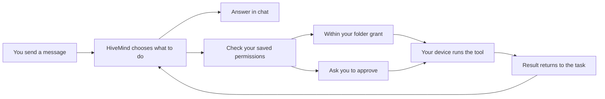
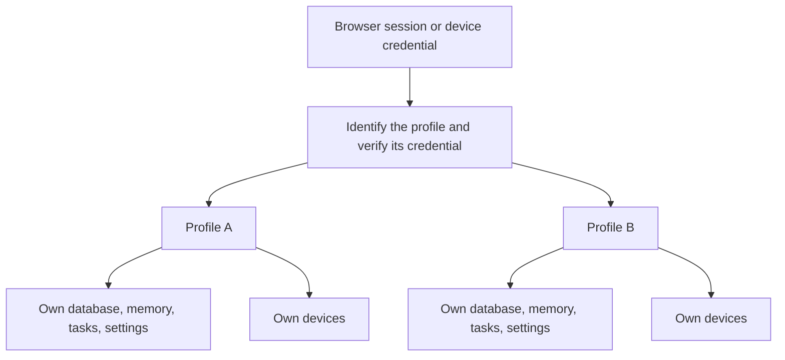
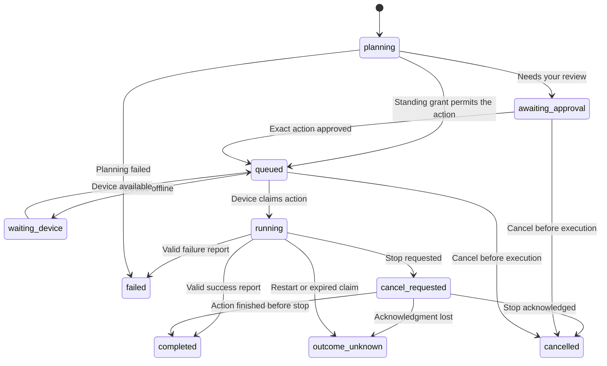

# How HiveMind works

You send a message from a phone or computer. HiveMind either answers or starts a task. For a task, it chooses a tool on one of your connected devices, checks your permissions, and waits for the result. You can keep chatting while that work happens.

You do not need to approve every file read. You can grant access to a selected folder once. HiveMind still asks before actions outside that grant, including commands, registered agents, and browser actions.

## What runs where

| Place | Its job |
|---|---|
| Your browser | Chat, profiles, device settings, approval, task progress, memory |
| HiveMind server | Sign-in, task records, permission checks, model calls, routing |
| Your chosen AI provider | Produces answers and proposes the next action from the context it receives |
| Desktop app | Runs file tools and optional commands or registered agents |
| Browser extension | Opens a URL or reads a tab you explicitly shared |

The server does the planning. The desktop app usually runs ordinary tools, without a separate AI on the device. A custom harness can expose additional tools through the connector contract. An optional registered agent can take a bounded goal and do its own reasoning; it may still use an online model.

Hosting HiveMind yourself does not automatically make inference local. Selected messages, recalled memories, task results, and file excerpts can go to the configured model provider. For local inference, the host owner can select a compatible model endpoint running on that host.

## Three separate connections

1. **Your HiveMind profile** signs you into this server. Its chats, memories, tasks, devices, and model settings belong to you.
2. **Your model account** gives that profile access to an AI service. It is not shared with other members.
3. **Your paired device** lets HiveMind request the tools you enabled on that device. Pairing does not give another profile access to it.

An administrator sends an invitation. A person creates a username and password, then connects their own model and devices. Invitations are single-use and expire. A pairing code is a different code, created inside that person's Devices page.

Each profile uses a separate state directory, database, model connection, memory object, and coordinator. The original owner keeps the existing root state directory during an upgrade. Other profiles use generated identifiers under `.state/profiles/`. Usernames do not become filesystem paths.

The gateway routes a request before a profile's API handles it. Routing identifiers are not credentials: the target profile still validates the session or device token against its own database. The host administrator can access server files, including the key that encrypts model settings. Account separation protects members from one another through the app; it does not conceal data from the host operator.

## Folder grants and sensitive actions

Choose a level in Devices for each desktop connector:

| Level | Allowed without another prompt |
|---|---|
| `ask` | Nothing; inspect every device action |
| `read` | `device.info`, `files.list`, and `files.read` in the selected folder |
| `folder` | The read actions plus `files.write` to create a new text file |

These grants apply only to enabled capabilities. A disabled read capability stays disabled even in folder mode. A write fails if the filename already exists. There is no basic file delete or overwrite tool.

The connector advertises a folder identifier derived from its canonical path and directory identity, plus a display name. A grant is tied to that identifier. Changing the folder invalidates the grant and pending affected work. Older connectors without a folder identity cannot receive a standing folder grant. The cloud checks approval again when dispatching queued work; the connector enforces the actual folder boundary on the device.

Browser actions, `command.run`, and `harness.run` always need approval of the exact stored action. A model response, webpage, file, or saved memory cannot grant permission. Commands and agents also require local enablement. By default the desktop shows a second confirmation with a 60-second timeout. Its user can choose to accept those exact approvals from HiveMind instead, useful when approving from a phone. The cloud cannot switch that local preference on.

Commands run as the device's operating-system user. Their working directory is not a sandbox. Folder grants cover the basic file tools; they do not constrain an arbitrary program after you approve it.

Registered agents have locally selected executable configurations. HiveMind sends an agent ID and bounded goal, not a replacement executable. The connector hashes the executable and configured script files, freezes that registration, and checks it again before launch. A changed manifest removes sensitive permissions until reviewed. This detects changes in a trusted local installation; it is not remote proof that a device is trustworthy.

## From a message to a result

1. The browser sends a message under its profile session.
2. The conversation call receives recent chat, relevant memory, the current device inventory, and recent task results.
3. It returns an answer, or an answer plus a task request. It cannot run device tools directly.
4. A task gets a stable parent ID. The coordinator asks the model for the next supported action.
5. That action becomes a child record with its own ID, device, arguments, and approval source. A standing folder grant may allow it; otherwise it waits for review.
6. The device asks the server for work over outbound HTTPS. The server checks permissions and gives it one temporary claim.
7. The connector records the task ID, checks local permissions, executes, saves the result locally, and reports it using the claim ID.
8. The coordinator uses the result to choose another step or finish. Its final answer links back to the parent task.

The conversation call and coordinator call are separate. They currently use the same selected model. Independent parent tasks can progress concurrently, but a parent has at most eight sequential steps and a device accepts one action at a time.

A `cloud.answer` step performs writing or reasoning without device tools. It does not grant access to the server's shell or files. The provider adapter also disables external-agent tools and rejects runtimes that could operate independently of that restriction.

## Task states and stopping

A parent waits in `waiting_children` while its child step runs. After a successful child, it plans the next step. If a child fails, is cancelled, or has an uncertain outcome, the parent stops too. The dashboard displays the active child's state instead of a generic “working” label.

| What the dashboard says | What to do |
|---|---|
| Your approval is needed | Review the exact device, action, and arguments in HiveMind |
| Confirm on the computer | Open the desktop dialog, unless remote approval was enabled locally |
| Waiting for device to reconnect | Open and connect the device app; browser work needs its popup open |
| Waiting for device to accept | The device is polling or finishing another action |
| Choosing the next action | The model is planning; the full wait, including its queue, is bounded |
| Outcome unconfirmed | Check the device before starting a new attempt |

A device claim lasts 120 seconds. It can be extended only by naming the matching active task and claim ID in a heartbeat while still valid. Staying online alone cannot keep an abandoned action running forever.

**Stop** prevents pending dispatch or requests cancellation on the active device. A running stop shortens the remaining claim to at most 30 seconds. A report may confirm a stop, failure, or an action that finished first. Lost confirmation becomes `outcome_unknown`. No stop operation undoes effects that already happened.

**Try again** creates a new parent task. Unknown outcomes require an explicit confirmation that the user checked the device. The connector's local journal prevents duplicate delivery from executing the same task twice. It can resend a saved report but must not repeat the action to repair a lost acknowledgment.

On server restart, running work becomes uncertain and interrupted planning fails. Saved queued actions and approval requests remain; waiting parents are reconciled with saved children. A successful connector report is accepted as success. Independent verification of every user goal remains future work.

## Disconnect and close

**Disconnect** revokes the device on the server and clears its local token after confirmation. It cancels pending work and makes active outcomes uncertain. The device disappears from the active device list and its old credential is rejected.

If the server cannot be reached, the connector stops locally, saves a pending revocation, blocks reconnection, and offers retry. It does not claim the server has removed the device yet. **Close** only pauses the desktop app; pairing remains saved. Reconnecting after a completed disconnect needs a fresh pairing code.

The conversation model receives an authoritative current device inventory. Old chat claiming a device was available does not establish current access.

## Memory without an unlimited context window

The server stores more than it sends in one model call. It selects a bounded working set:

- Up to 12 recent messages, preserving the current request, within a 24,000-character serialized conversation budget.
- Older messages summarized in batches of 12; four batch summaries can form a broader summary.
- Up to six recalled records and 6,000 characters, selected by word overlap from saved notes, summaries, and original source excerpts.
- Saved notes the user writes or explicitly accepts from suggestions with source evidence.

The conversation instructions and device/task previews add more context outside those budgets. These are character allowances, not exact token counts. Summaries can lose details and word matching can miss related concepts. The implementation does not claim infinite memory.

Archived test records and task-activity messages are excluded from recall. Deleting a saved note resets older recalled conversation and summaries so paraphrases do not immediately restore it. Visible chat remains. This also drops unrelated earlier recall; task records, backups, and already-running model calls have separate retention behavior.

## Module boundaries

| Module | Responsibility |
|---|---|
| `profiles.py` | Invitations, identity, password verification, session routing, account lifecycle |
| `app.py` | One profile's API, chat, devices, approvals, results, memory and model settings |
| `store.py` | SQLite records and additive schema migration |
| `coordinator.py` | Parent/child planning, permission decisions, continuation and cancellation |
| `permissions.py` | Standing-grant rules and folder identity checks |
| `memory.py` | Context selection, summaries, retrieval and saved notes |
| `providers.py` | Model access without device execution privileges |
| `account_login.py` | Isolated provider authorization helper |
| `connectors/desktop/node.py` | Polling, file tools, local journal and scope enforcement |
| `connectors/desktop/harness.py` | Command and registered-agent execution |
| `connectors/browser/popup.js` | Explicit tab sharing, browser actions, polling and journal |
| `web/` | User controls; only static assets are cached, never authenticated API responses |

The server currently uses one process and SQLite, with a shared limit on simultaneous model calls. It is suited to a small invited group. Horizontal scaling needs a durable job queue and distributed scheduling. See [operations](operations.md), the [connector contract](connector-contract.md), [security boundaries](security.md), and [subteam handoffs](subteams.md).
